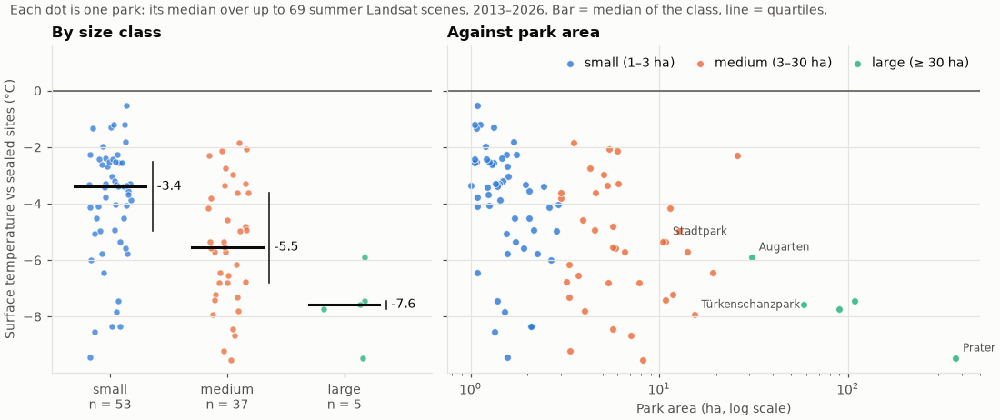

# HeatMap-Predict
Comparing different areas in Vienna to see how vegetation and urban areas influence heat maps.
Our project investigates how urban infrastructure and green spaces drive the Urban Heat Island (UHI) effect in our city. First, we will analyze satellite thermal heat maps and vegetation data alongside ground temperature measurements to compare the cooling influence of small, medium, and large parks against heavily sealed control areas (such as railway corridors, high-traffic roads, and dense apartment complexes). Second, we will examine historical satellite and weather data to separate the effects of long-term climate change from local urban expansion over the years. Finally, using these datasets, we will train a predictive Machine Learning (ML) model to simulate how local temperatures and heat maps would shift if a neighborhood's layout were modified—such as replacing a parking lot with a pocket park or adding a new housing block.

## Datasets

[docs/datasets.md](docs/datasets.md) lists the data sources for each part of the plan, with
licences, download routes and which ones need an account.

## Multi-scene analysis: parks vs sealed areas, summers 2013–2026

`python -m uhi.multi_scene` repeats the park comparison on every usable summer Landsat scene
instead of one morning, for 95 parks instead of six.

### Result

Surface temperature of parks minus the mean of three sealed reference sites (Westbahn tracks,
Westgürtel, dense housing in Neubau) in the same scene. Negative means the park is cooler.

| Park size | Parks | Median difference | Middle half of the parks | Middle half of the scenes |
|---|---:|---:|---:|---:|
| small (1–3 ha) | 53 | −3.4 °C | −5.0 to −2.5 °C | −4.0 to −3.0 °C |
| medium (3–30 ha) | 37 | −5.5 °C | −6.8 to −3.6 °C | −6.3 to −4.8 °C |
| large (≥ 30 ha) | 5 | −7.6 °C | −7.7 to −7.4 °C | −8.5 to −6.9 °C |

Every size class was cooler than the sealed sites in all 69 scenes. The three sealed sites
stay within 1 °C of their common mean.



**Scenes.** 320 Landsat 8/9 scenes from June to August 2013–2026 make 175 overpasses (two
scenes cut from the same overpass count once). 69 were used. 99 were dropped because less than
80 % of the city was clear or covered, and 7 because a sealed reference site was masked.
A site is skipped in a scene when less than 80 % of its pixels are usable.

**Water matters more than expected.** 31 of the 95 parks lie within 100 m of mapped water
(Danube, Alte Donau, Donaukanal, Wienfluss). They are among the coolest sites even when they
have little vegetation, because a 100 m thermal pixel at the bank is partly water. With them
included, greenness explains nothing (r = −0.06). Among the 64 parks away from water the
relation is clear: r = −0.67, about 1.2 °C cooler per 0.1 NDVI. Away from water the size
classes are also closer together: −3.3 °C (small, 43 parks), −4.2 °C (medium, 20) and −5.9 °C
(large, Augarten only).


**Size and greenness together.** For the parks away from water, a fit with both gives 1.1 °C
per 0.1 NDVI and 1.5 °C per tenfold area, and explains 56 % of the variation between parks.
The two are nearly independent here (r = 0.13).

**Per year.** No trend is visible, and none should be read into this plot: summers have
between 2 and 11 scenes, and the dip in 2016 rests on two.


### What this can and cannot show

- **Small parks.** Landsat measures temperature at 100 m and delivers it resampled to 30 m.
  A 1 ha park is one real measurement that also sees the streets around it, so the −3.4 °C
  for small parks is a lower bound on their true surface cooling, and part of the "larger is
  cooler" pattern is the sensor rather than the parks. Parks under 1 ha were left out for
  this reason. Sentinel-2 gives NDVI at 10 m, but that does not sharpen the temperature.
- **Surface, not air; morning, not night.** All scenes are from about 09:40 UTC. How much
  cooler the air is, and what happens at night, is not in this data.
- **The reference is three sites in the west of the inner city.** Parks elsewhere are compared
  against them, so distance, elevation and surroundings are mixed into the difference.
- **Gaps in the temperature product.** About 9 % of the Vienna window never has a surface
  temperature. 12 parks fall in these gaps and were dropped (listed in `stats.json`).
- **NDVI is a summer median of 12 clear Sentinel-2 dates from 2022–2026**, not matched to each
  Landsat date. Park outlines and land use are the current ones for all years.
- **"Near water" is a simple rule** (within 100 m of water in the 2022 land-use map). It also
  flags parks next to the concrete Wienfluss channel, such as the Stadtpark.

### Run it

```bash
python3 -m venv .venv
.venv/bin/pip install -r requirements.txt
.venv/bin/python -m uhi.multi_scene
```

No account or key is needed. The first run downloads about 320 Landsat windows and 12
Sentinel-2 dates for Vienna into `data/cache/` (about 1.1 GB, not committed) and takes
around 15 minutes. Later runs read the cache, need no network and take under a minute.
`--help` lists the thresholds; `--refresh` repeats the catalogue search to pick up new scenes.

Outputs in `results/multi_scene/`:

| File | Content |
|---|---|
| `scene_site.csv` | one row per scene and site: mean temperature, Landsat NDVI, difference to the sealed mean |
| `site_summary.csv` | per site: area, size class, near-water flag, Sentinel-2 NDVI, median and quartiles of the difference |
| `class_summary.csv` | per size class, for all parks and for parks away from water |
| `year_summary.csv` | per summer and size class |
| `scenes.csv` | every overpass considered and why it was used or skipped |
| `stats.json` | counts, Sentinel-2 dates, dropped sites, correlations |
| `cooling_*.png` | the three plots above |

### Tests

```bash
.venv/bin/pip install pytest
.venv/bin/python -m pytest
```

The tests cover the unit conversions, cloud masking, site statistics and the raster reader on
small synthetic arrays, without network. GitHub Actions runs them on every pull request.

## Prototype: one Landsat scene

`prototype/lst_parks_vs_sealed.py` is a proof of concept for the first part of the plan. It

1. finds a Landsat 8/9 scene for one day on the Microsoft Planetary Computer and reads surface
   temperature, red and near-infrared for Vienna,
2. loads park outlines and the 2022 land-use map from the Stadt Wien open data WFS,
3. computes mean surface temperature and NDVI for six parks and three sealed control areas,
4. writes a table and a map to `prototype/output/`.

No account or API key is needed. It needs Python 3.10+ and an internet connection, and takes
about a minute.

```bash
python3 -m venv .venv
.venv/bin/pip install -r prototype/requirements.txt
.venv/bin/python prototype/lst_parks_vs_sealed.py              # default scene: 2026-08-09
.venv/bin/python prototype/lst_parks_vs_sealed.py --date 2025-08-14
```

`--date` must be a day with a Landsat overpass that covers the whole city; the script stops
with a message otherwise.

### Result for 9 August 2026, 09:44 UTC (Landsat 8, cloud cover 0.01 %)


| Site | Type | Area (ha) | Pixels | Mean LST (°C) | Mean NDVI | vs sealed mean (°C) |
|---|---|---:|---:|---:|---:|---:|
| Esterhazypark | park, small | 1.0 | 12 | 38.6 | 0.57 | −1.1 |
| Alois-Drasche-Park | park, small | 1.6 | 17 | 37.0 | 0.71 | −2.7 |
| Stadtpark | park, medium | 10.8 | 122 | 35.2 | 0.60 | −4.5 |
| Türkenschanzpark | park, medium | 15.3 | 173 | 33.0 | 0.73 | −6.7 |
| Augarten | park, medium | 32.0 | 333 | 35.5 | 0.63 | −4.2 |
| Prater | park, large | 373.5 | 3964 | 33.1 | 0.74 | −6.6 |
| Westbahn rail corridor | sealed, railway | 14.0 | 150 | 41.0 | 0.18 | +1.3 |
| Westgürtel (road) | sealed, road | 17.4 | 194 | 39.0 | 0.29 | −0.7 |
| Neubau dense housing | sealed, housing | 91.8 | 965 | 39.2 | 0.23 | −0.5 |

The three sealed areas average 39.7 °C. Parks are 1 to 7 °C cooler, and the two pocket parks
show the smallest difference. Across all pixels inside the city boundary, surface temperature
and NDVI correlate at r = −0.52.

Read this as a working pipeline, not as a finding:

- It is one scene on one morning. Surface temperature is not air temperature.
- Landsat's thermal sensor measures at 100 m and is resampled to 30 m, so a 1 ha park is about
  one real measurement mixed with its surroundings. The small difference for pocket parks may
  be the sensor, not the park.
- About 9 % of the Vienna window has no surface temperature in the Landsat product (white
  patches on the map), including part of the Prater.
- Park size is not the only thing that differs between these sites: tree cover, water and
  what surrounds them differ too.
- The Gürtel area is a 40 m buffer around a hand-drawn line, clipped to mapped street space;
  the other areas come straight from the city's layers.
