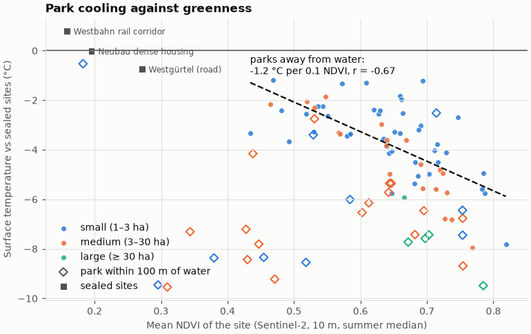
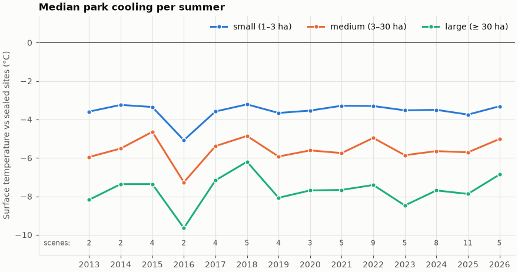
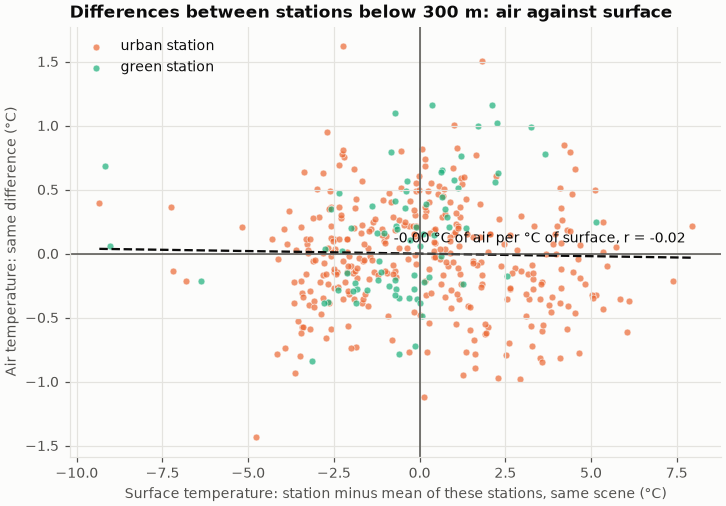
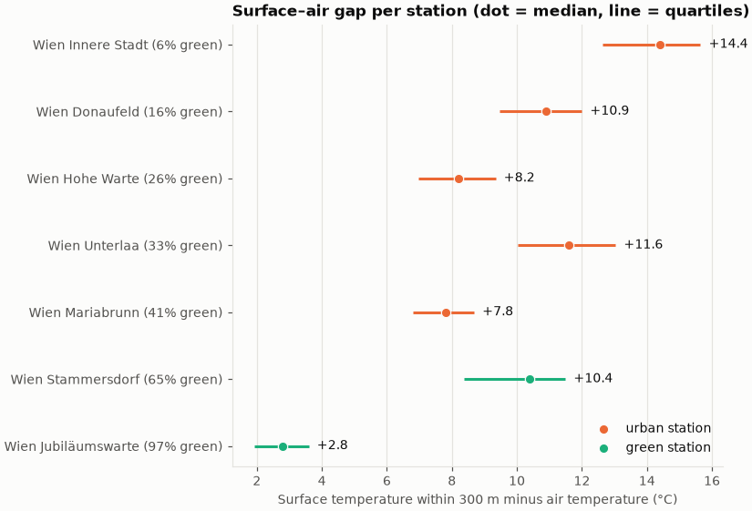
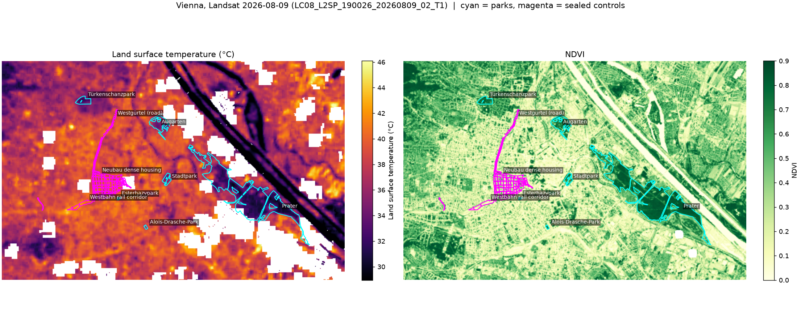

# HeatMap-Predict
Comparing different areas in Vienna to see how vegetation and urban areas influence heat maps.
Our project investigates how urban infrastructure and green spaces drive the Urban Heat Island (UHI) effect in our city. First, we will analyze satellite thermal heat maps and vegetation data alongside ground temperature measurements to compare the cooling influence of small, medium, and large parks against heavily sealed control areas (such as railway corridors, high-traffic roads, and dense apartment complexes). Second, we will examine historical satellite and weather data to separate the effects of long-term climate change from local urban expansion over the years. Finally, using these datasets, we will train a predictive Machine Learning (ML) model to simulate how local temperatures and heat maps would shift if a neighborhood's layout were modified—such as replacing a parking lot with a pocket park or adding a new housing block.

## Datasets

[docs/datasets.md](docs/datasets.md) lists the data sources for each part of the plan, with
licences, download routes and which ones need an account.

## Multi-scene analysis: parks vs sealed areas, summers 2013–2026

`python -m uhi.multi_scene` repeats the park comparison on every usable summer Landsat scene
instead of one morning, for 95 parks instead of six.

### Result

Surface temperature of parks minus the mean of eleven sealed reference sites across the city,
in the same scene. Negative means the park is cooler. The headline is for **parks away from
water**:

| Park size | Parks | Median difference | Middle half of the parks | Middle half of the scenes |
|---|---:|---:|---:|---:|
| small (1–3 ha) | 43 | −3.1 °C | −3.7 to −2.2 °C | −3.3 to −2.8 °C |
| medium (3–30 ha) | 20 | −3.9 °C | −5.2 to −2.9 °C | −4.4 to −3.7 °C |
| large (≥ 30 ha) | 1 | −5.7 °C | Augarten only | −6.4 to −5.2 °C |

Every size class was cooler than the sealed sites in all 59 scenes.

**Water bodies cool more than vegetation.** The 31 parks within 100 m of mapped water (Danube,
Alte Donau, Donaukanal, Wienfluss) are reported separately: their median is −7.0 °C, against
−3.2 °C for the 64 parks away from water, and it hardly depends on size (−6.6 °C small,
−6.6 °C medium, −7.4 °C large). They are cool even with little vegetation, because a 100 m
thermal pixel at the bank is partly water. Mixed in with the others they hide the effect of
greenness (r = −0.04 over all 95 parks); among the parks away from water it is clear:
r = −0.66, about 1.2 °C cooler per 0.1 NDVI.




**The baseline hardly moves the headline.** With only the three original sealed sites in the
western inner city (Westbahn tracks, Westgürtel, dense housing in Neubau), the same parks on
the same 59 scenes come out 0.3 °C cooler:

| Park size, away from water | Citywide baseline (11 sites) | Western baseline (3 sites) | Shift |
|---|---:|---:|---:|
| small | −3.1 °C | −3.3 °C | +0.3 °C |
| medium | −3.9 °C | −4.2 °C | +0.3 °C |
| large | −5.7 °C | −5.9 °C | +0.3 °C |

The western sites are slightly hotter than sealed areas elsewhere, so parks looked slightly
cooler against them. The eleven sealed sites all lie within about 1 °C of their common mean
(−0.9 to +1.1 °C).

**Sealed reference sites.** Besides the three western sites, the citywide baseline takes, per
land-use class and district (Realnutzungskartierung 2022), the largest connected area that is
at least 5 ha, has at most 10 % of its area within 100 m of water and at most 10 % of its
pixels in the permanent gaps of the temperature product. All eight rules found a site:

| Site | Area |
|---|---:|
| Favoriten dense housing | 200 ha |
| Favoriten rail yard | 62 ha |
| Floridsdorf industry | 50 ha |
| Brigittenau dense housing | 47 ha |
| Liesing industry | 26 ha |
| Favoriten logistics | 17 ha |
| Donaustadt retail | 13 ha |
| Simmering industry | 6 ha |

No category dropped out, but industry is thinly represented for a reason: much of Vienna's
industrial land has no temperature in the Landsat product. In Liesing and Simmering the rule
had to pass over the largest industrial areas (150 ha and 41 ha, about half to all of their
pixels in gaps) and took much smaller ones. Car parks have no site of their own: no area of
that class is large enough, so retail in Donaustadt stands in for them.

**Scenes.** 320 Landsat 8/9 scenes from June to August 2013–2026 make 175 overpasses (two
scenes cut from the same overpass count once). 59 were used. 99 were dropped because less than
80 % of the city was clear or covered, and 17 because one of the eleven sealed sites was
masked (with three sites it was 7, leaving 69). A site is skipped in a scene when less than
80 % of its pixels are usable.

**Size and greenness together.** For the parks away from water, a fit with both gives 1.1 °C
per 0.1 NDVI and 1.5 °C per tenfold area, and explains 55 % of the variation between parks.
The two are nearly independent here (r = 0.13).

**Per year.** No trend is visible, and none should be read into this plot: summers have
between 1 and 10 scenes.



### What this can and cannot show

- **Small parks.** Landsat measures temperature at 100 m and delivers it resampled to 30 m.
  A 1 ha park is one real measurement that also sees the streets around it, so the −3.1 °C
  for small parks is a lower bound on their true surface cooling, and part of the "larger is
  cooler" pattern is the sensor rather than the parks. Parks under 1 ha were left out for
  this reason. Sentinel-2 gives NDVI at 10 m, but that does not sharpen the temperature.
- **Surface, not air; morning, not night.** All scenes are from about 09:40 UTC. How much
  cooler the air is, and what happens at night, is not in this data.
- **The reference is a handful of sealed sites.** Parks are compared against their mean, so
  distance, elevation and surroundings are mixed into the difference. The citywide baseline
  reduces this but does not remove it.
- **Gaps in the temperature product.** About 9 % of the Vienna window never has a surface
  temperature. 12 parks fall in these gaps and were dropped (listed in `stats.json`).
- **NDVI is a summer median of 12 clear Sentinel-2 dates from 2022–2026**, not matched to each
  Landsat date. Park outlines and land use are the current ones for all years.
- **"Near water" is a simple rule** (within 100 m of water in the 2022 land-use map). It also
  flags parks next to the concrete Wienfluss channel, such as the Stadtpark.

### Run it

The run downloads about 1.1 GB and is meant for GitHub Actions, not for a laptop or a shared
server:

```bash
gh workflow run analysis.yml -f step=multi-scene -f years=2013-2026
gh run watch
gh run download --name results-multi-scene --dir results
```

The workflow only reads the repository. It keeps the downloaded windows in the Actions cache,
so later runs do not fetch everything again, and uploads `results/` as an artifact. Committing the small
result files happens through a normal pull request.

Locally the same thing is:

```bash
python3 -m venv .venv
.venv/bin/pip install -r requirements.txt
.venv/bin/python -m uhi.multi_scene
```

No account or key is needed. The first run downloads about 320 Landsat windows and 12
Sentinel-2 dates for Vienna into `data/cache/` (not committed) and takes around 15 minutes.
Later runs read the cache, need no network and take under a minute. `--help` lists the
thresholds; `--refresh` repeats the catalogue search to pick up new scenes.

Outputs in `results/multi_scene/`:

| File | Content |
|---|---|
| `scene_site.csv` | one row per scene and site: mean temperature, Landsat NDVI, difference to the sealed mean |
| `site_summary.csv` | per site: area, size class, near-water flag, Sentinel-2 NDVI, median and quartiles of the difference |
| `class_summary.csv` | per baseline, subset (away from water, near water, all parks) and size class |
| `baseline_comparison.csv` | parks away from water: citywide baseline against the three western sites, same scenes |
| `year_summary.csv` | per summer and size class |
| `scenes.csv` | every overpass considered and why it was used or skipped |
| `stats.json` | counts, Sentinel-2 dates, dropped sites, correlations |
| `cooling_*.png` | the three plots above |

### Tests

```bash
.venv/bin/pip install pytest
.venv/bin/python -m pytest
```

The tests cover the unit conversions, cloud masking, site statistics, the summaries and the
raster reader on small synthetic arrays, and run the whole pipeline on a synthetic city, all
without network. GitHub Actions runs them on every pull request.

## Ground truth: surface temperature against weather stations

`python -m uhi.stations` asks how far the surface-temperature differences above can be read as
air-temperature differences, which is what people feel and what the model will have to predict.

### Answer

**Not directly.** At the late-morning Landsat overpass, the places that are hotter at the
surface are not measurably warmer in the air at 2 m. The park results above are differences
in surface temperature and should be reported as such.

- **The surface is much hotter than the air:** by 9.8 °C in the median (middle half 7.1 to
  12.1 °C) over 485 station–overpass pairs, from +3.0 °C at the forested Jubiläumswarte to
  +14.4 °C at Innere Stadt.
- **Between the six stations below 300 m, the surface differs a lot and the air hardly at
  all.** Their median surface temperatures span 6.1 °C (34.5 °C at Mariabrunn to 40.6 °C at
  Innere Stadt); their median air temperatures span about 1 °C, and Innere Stadt, the hottest
  surface, has the coolest air of the six. Scene by scene, a station's surface deviation from
  the group says nothing about its air deviation: slope 0.00 °C of air per °C of surface,
  r = 0.01.
- **The one apparent link is altitude.** With the Jubiläumswarte (450 m) included, the slope
  is 0.10 and r = 0.60. But its air is about 1.8 °C cooler than at the other stations, and
  250 m of height accounts for about 1.6 °C of that on its own.
- **Day to day the two do move together** at every station (r = 0.68 to 0.92 over scenes): a
  hot day is hot at the surface and in the air. That is weather, not a difference between
  places.





| Station | Altitude | Green within 300 m | Overpasses | Air (median) | Surface (median) | Surface − air |
|---|---:|---:|---:|---:|---:|---:|
| Innere Stadt | 177 m | 6 % | 74 | 26.4 °C | 40.6 °C | +14.4 °C |
| Donaufeld | 160 m | 16 % | 74 | 27.4 °C | 37.3 °C | +10.9 °C |
| Hohe Warte | 198 m | 26 % | 74 | 26.9 °C | 34.6 °C | +8.2 °C |
| Unterlaa | 200 m | 33 % | 72 | 26.8 °C | 38.4 °C | +11.6 °C |
| Mariabrunn | 225 m | 41 % | 50 | 26.8 °C | 34.5 °C | +7.9 °C |
| Stammersdorf | 191 m | 65 % | 73 | 26.7 °C | 36.6 °C | +10.5 °C |
| Jubiläumswarte | 450 m | 97 % | 68 | 25.1 °C | 27.9 °C | +3.0 °C |

**Suspect points removed.** 9 of 494 station–overpass pairs had a surface colder than the air
(4 at the Jubiläumswarte, 2 each at Mariabrunn and Stammersdorf, 1 at Hohe Warte). In late
morning in summer that is most likely cloud or cloud shadow the Landsat mask missed, so they
are left out. The conclusion does not depend on them: with all 494 pairs the slope among the
low stations was also 0.00 (r = −0.02) and the median gap 9.6 °C.

### Limits: what the model will and will not predict

- The model in the third part of the plan predicts **land surface temperature**, as Landsat
  sees it in the late morning.
- The comparison above shows that surface-temperature differences between places **cannot be
  read as air-temperature differences**. A scenario result such as "this car park becomes
  4 °C cooler as a park" is a statement about the ground, not about what a person feels.
- Air temperature would need other data: night-time thermal scenes (ECOSTRESS, which needs a
  free NASA account that the project does not have for now) or measurements from sensors
  inside the neighbourhoods.

### What this does not show

- **It does not show that parks fail to cool the air.** Weather stations are placed on open,
  mostly grassed ground away from buildings, by design. None stands in a street canyon, on a
  rail yard or inside a small park, so the stations do not sample the contrast the park
  analysis is about. Seven stations cannot settle it.
- **One time of day.** All overpasses are around 09:40 to 09:45 UTC, late morning, when the
  air is well mixed. Air-temperature differences between city and green areas are largest in
  the evening and at night, which Landsat does not see.
- **The urban/green split is crude:** 50 % green land use within 300 m puts only Stammersdorf
  and the Jubiläumswarte in the green class, so `urban_vs_green.csv` (surface 5.0 °C, air
  0.6 °C) is mostly the hill station again.
- For the model this means: surface temperature is a target it can be trained on, but a
  claim about felt temperature needs air measurements inside the neighbourhoods, at the hours
  that matter.

### Method

1. Takes the summer Landsat overpasses with at least 80 % of the city clear: 76 of them. (The
   park analysis uses 59, because it also needs all sealed reference sites clear.)
2. Loads the Vienna stations of GeoSphere Austria's 10-minute dataset (`klima-v2-10min`,
   open, no key, CC BY 4.0) and interpolates air temperature at 2 m to the minute of each
   overpass. Three stations are listed under two ids; each station is counted once.
   Pairs where the surface reads colder than the air are dropped as likely cloud.
3. Reads the Landsat surface temperature at the station's pixel and as the mean within 300 m.
   The 300 m value is the main one, since one thermal measurement is 100 m wide; the single
   pixel gives the same picture.
4. Classes each station as "urban" or "green" by the share of green land use within 300 m
   (2022 land-use map, 50 % threshold).

Run it with `gh workflow run analysis.yml -f step=stations`, then
`gh run download --name results-stations --dir results`. Outputs in `results/stations/`:

| File | Content |
|---|---|
| `station_scene.csv` | one row per station and overpass: air temperature, surface temperature (pixel and 300 m) |
| `station_summary.csv` | per station: surface minus air (median, quartiles), correlation over scenes, green share, altitude |
| `urban_vs_green.csv` | per scene, urban stations minus green stations, for the surface and for the air |
| `stats.json` | overall bias and correlation; how much of a surface difference between places shows up in the air |
| `*.png` | surface against air, the gap per station, differences between stations below 300 m |

## Warming split: regional climate against city growth, summers 1981–2026

`python -m uhi.warming_split` is the second part of the plan: how much of Vienna's summer
warming since the 1980s is the regional climate, and how much comes from the city itself.
Results follow in a separate pull request once the run on GitHub Actions is in.

### Method

1. **Air, regional against urban.** June–August mean air temperature per year. The main
   split uses the homogenised HISTALP series: Wien-Hohe Warte against Eisenstadt, Retz and
   St. Pölten, the nearest low-lying stations that HISTALP carries up to now. These three
   are small towns 40–65 km away, not open country, so this urban extra is "Vienna against
   small towns" and probably a lower bound. The cross-check
   uses GeoSphere Austria's monthly station series, which are not homogenised but include
   stations closer to the city. Urban there: Innere Stadt (from 1985) and Hohe Warte. Rural:
   every station within 45 km, below 300 m, outside the city, with at least 85 % of the
   summers and less than 10 % building footprint within 1 km (GHSL). The rural trend is the regional
   part; the trend of urban minus rural is the urban extra. Only summers in which all these
   stations have data are used, so the parts add up. The SPARTACUS 1 km grid, sampled every
   4 km in a ring 15–40 km around the centre, is a second regional series.
2. **Land use.** All 17 editions of the Realnutzungskartierung (1981–2024) are put on the
   30 m Landsat grid and reduced to sealed, farmland, forest, other green, water and other.
   A pixel is *converted* when it is green in every edition up to one point and sealed in
   every edition after it, with at least two editions on each side. GHSL built-up surface
   (1975–2020) is a cross-check from an independent source.
3. **Surface.** Every usable summer scene of Landsat 4/5 (1984–2011), Landsat 7 (1999–2012)
   and Landsat 8/9 (2013–). Only differences within one scene are used: land that stayed
   sealed minus land that stayed green, over time; and converted land minus stable green,
   before against after the conversion. Scenes between the last green and the first sealed
   edition are left out.

HISTALP: Auer I. et al. (2007), HISTALP – historical instrumental climatological surface
time series of the Greater Alpine Region, Int. J. Climatol. 27, 17–46; data from
<https://www.zamg.ac.at/histalp/>, Austrian series free for non-commercial research. Only
the summer means used here are stored in this repository.

Two things in the data shaped this:

- **The editions up to 2005 have two-letter codes and no published legend.** The codes are
  translated by where each one lies in the 2007/08 edition, which names its classes
  (`landuse_codes.csv`). A code whose area is less than 70 % one group counts as unclear.
  Areas that flip from green to sealed exactly between 2005 and 2007/08 are reported but
  kept out of the headline, because that flip can be the change of scheme.
- **Landsat 7 is used only up to 2012**, to bridge the year between Landsat 5 and 8. After
  2013 it adds little, has striped gaps, and from 2017 its orbit drifted to an earlier hour.

Run it with `gh workflow run analysis.yml -f step=warming-split -f years=1981-2026`, then
`gh run download --name results-warming-split --dir results`. The first run downloads about
4 GB (some 1,100 Landsat windows) and takes about an hour. Outputs in `results/warming_split/`:

| File | Content |
|---|---|
| `stats.json` | the headline split, all trends with intervals, counts |
| `air_homogenised.csv` | HISTALP summer means per station and year |
| `air_summer.csv`, `air_trends.csv` | raw series: summer mean, minimum and maximum per place and year; trend per place |
| `stations.csv` | stations used, their role, built-up share, relocations |
| `landuse_by_edition.csv` | hectares per group and edition, with GHSL built-up surface |
| `landuse_codes.csv` | the old two-letter codes and the group each was given |
| `scenes.csv` | every overpass: sensor, time, sun elevation, used or why not, temperature per zone |
| `surface_gap_by_year.csv` | sealed minus green per summer |
| `cohorts.csv`, `event_study.csv` | converted land per conversion period, before and after |
| `*.png` | air trends, land use, sealed minus green, converted land |

## Prototype: one Landsat scene

`prototype/lst_parks_vs_sealed.py` is a proof of concept for the first part of the plan. It

1. finds a Landsat 8/9 scene for one day on the Microsoft Planetary Computer and reads surface
   temperature, red and near-infrared for Vienna,
2. loads park outlines and the 2022 land-use map from the Stadt Wien open data WFS,
3. computes mean surface temperature and NDVI for six parks and three sealed control areas,
4. writes a table and a map to `prototype/output/`.

No account or API key is needed. It needs Python 3.10+ and an internet connection, and takes
about a minute.

```bash
python3 -m venv .venv
.venv/bin/pip install -r prototype/requirements.txt
.venv/bin/python prototype/lst_parks_vs_sealed.py              # default scene: 2026-08-09
.venv/bin/python prototype/lst_parks_vs_sealed.py --date 2025-08-14
```

`--date` must be a day with a Landsat overpass that covers the whole city; the script stops
with a message otherwise.

### Result for 9 August 2026, 09:44 UTC (Landsat 8, cloud cover 0.01 %)



| Site | Type | Area (ha) | Pixels | Mean LST (°C) | Mean NDVI | vs sealed mean (°C) |
|---|---|---:|---:|---:|---:|---:|
| Esterhazypark | park, small | 1.0 | 12 | 38.6 | 0.57 | −1.1 |
| Alois-Drasche-Park | park, small | 1.6 | 17 | 37.0 | 0.71 | −2.7 |
| Stadtpark | park, medium | 10.8 | 122 | 35.2 | 0.60 | −4.5 |
| Türkenschanzpark | park, medium | 15.3 | 173 | 33.0 | 0.73 | −6.7 |
| Augarten | park, medium | 32.0 | 333 | 35.5 | 0.63 | −4.2 |
| Prater | park, large | 373.5 | 3964 | 33.1 | 0.74 | −6.6 |
| Westbahn rail corridor | sealed, railway | 14.0 | 150 | 41.0 | 0.18 | +1.3 |
| Westgürtel (road) | sealed, road | 17.4 | 194 | 39.0 | 0.29 | −0.7 |
| Neubau dense housing | sealed, housing | 91.8 | 965 | 39.2 | 0.23 | −0.5 |

The three sealed areas average 39.7 °C. Parks are 1 to 7 °C cooler, and the two pocket parks
show the smallest difference. Across all pixels inside the city boundary, surface temperature
and NDVI correlate at r = −0.52.

Read this as a working pipeline, not as a finding:

- It is one scene on one morning. Surface temperature is not air temperature.
- Landsat's thermal sensor measures at 100 m and is resampled to 30 m, so a 1 ha park is about
  one real measurement mixed with its surroundings. The small difference for pocket parks may
  be the sensor, not the park.
- About 9 % of the Vienna window has no surface temperature in the Landsat product (white
  patches on the map), including part of the Prater.
- Park size is not the only thing that differs between these sites: tree cover, water and
  what surrounds them differ too.
- The Gürtel area is a 40 m buffer around a hand-drawn line, clipped to mapped street space;
  the other areas come straight from the city's layers.
